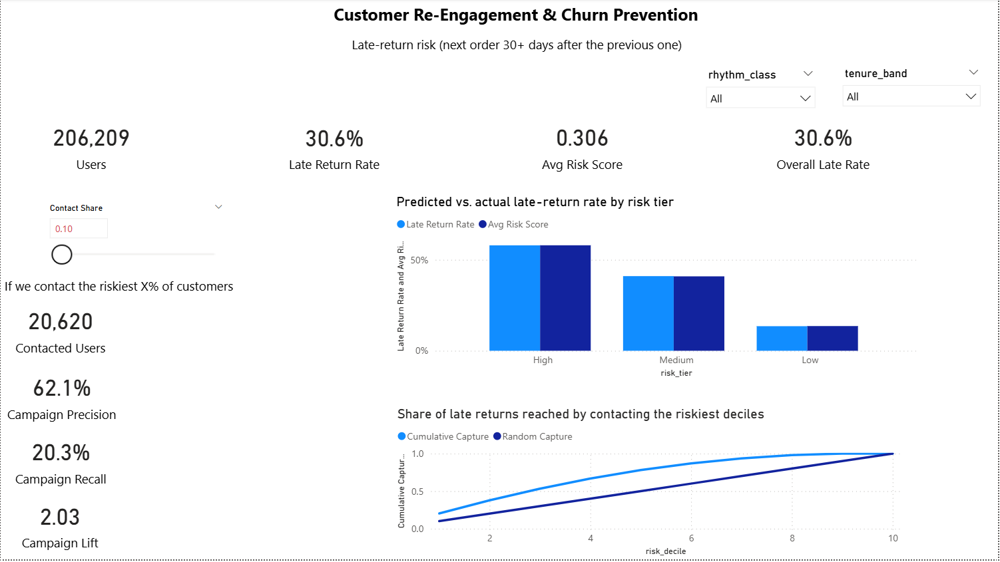
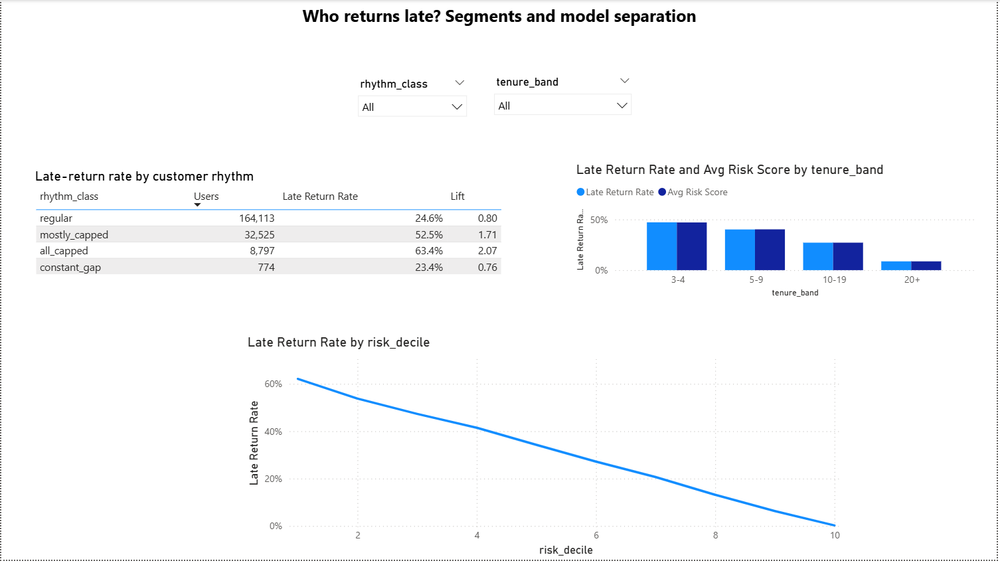
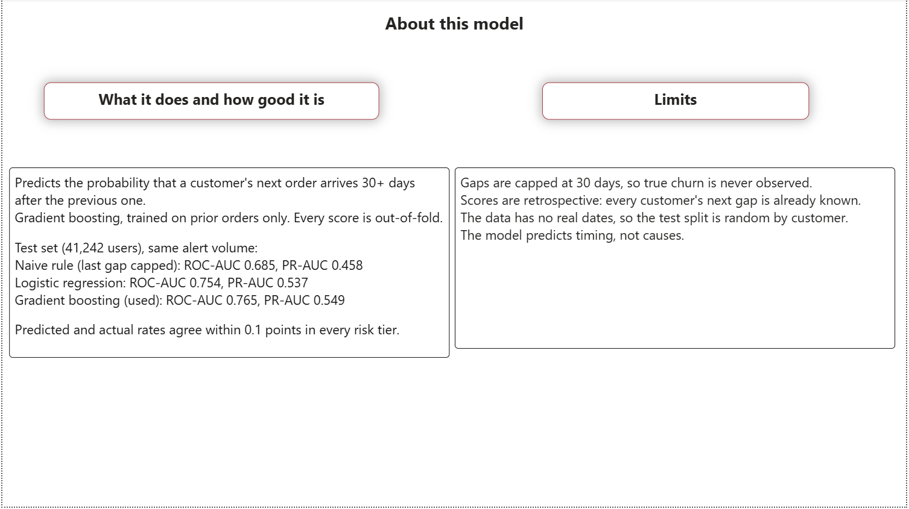

# Customer Re-Engagement & Churn Prevention Engine
### Predicting late returns in e-grocery with PostgreSQL, Python, and Power BI

> **Status:** Complete (Phases 1-4)

## TL;DR

- End-to-end pipeline on the [Instacart Market Basket](https://www.kaggle.com/datasets/psparks/instacart-market-basket-analysis) data: **3.4M orders, 33.8M basket lines, 206,209 customers**. PostgreSQL for modeling and features, Python for statistics and machine learning, Power BI for the executive dashboard.
- **Question:** which customers are about to go quiet, and can we tell early enough to act?
- **Answer:** a gradient-boosting model ranks customers by the probability that their next order arrives **30 or more days** after the previous one (30.6% of customers).
  - Contacting the riskiest **20%** reaches **38%** of all late returns, with a hit rate of **57.9%** (1.9x random targeting).
  - The riskiest **50%** hold about **78%** of all late returns.
  - Probabilities are **calibrated**: predicted and actual rates agree within 0.1 percentage points in every risk tier.
- Along the way: found and handled **right-censoring** (11.5% of gaps are capped at 30 days) and ran a **placebo test** showing that a naive "z-score >= 2" churn rule mostly measures skew in the gap distribution, which is why the model targets the observed 30+ day gap instead.

## Dashboard





The dashboard includes a **contact-budget what-if slider**: pick the share of customers to contact and see the precision, recall, and lift of the campaign. DAX formulas are in [docs/dax_measures.md](docs/dax_measures.md).

## Business problem

An e-grocery business rarely sees customers leave. They just stop ordering. A fixed rule such as "no order in 30 days means churned" ignores each customer's own rhythm: a weekly shopper who goes quiet for 21 days is in trouble, while a monthly shopper is perfectly normal.

This project asks three questions:
1. How do we describe a customer's normal reorder rhythm, and when is it measurable at all?
2. Does the final gap before the data ends differ from a customer's own history, once we account for censoring?
3. Can we predict who will return late, and show the business where to act?

## Dataset

| File | One row is... | Rows |
|---|---|---|
| `aisles.csv` | an aisle | 134 |
| `departments.csv` | a department | 21 |
| `products.csv` | a product | 49,688 |
| `orders.csv` | an order | 3,421,083 |
| `order_products__prior.csv` | a product in a prior order | 32,434,489 |
| `order_products__train.csv` | a product in a train order | 1,384,617 |

Data quirks that shaped the design (all checked in `sql/04_data_quality.sql`):
- **No real dates.** Time exists only as `days_since_prior_order` and `order_number`.
- **Gaps are capped at 30 days.** 369,323 of 3,214,874 prior gaps (11.49%) equal 30 and really mean "30 or more".
- **NULL gap = first order**, exactly one per user (206,209).
- **Each user's last order** is labeled `train` or `test`. The 75,000 `test` orders have no basket rows.
- **Histories stop at 100 orders** (1,374 users hit the ceiling).

## Architecture

```
Kaggle CSVs --\copy--> raw schema --views--> analytics --SQL--> features
 (6 files)             (PostgreSQL)                               |
                                                                  v
                    Python: hypothesis tests, z-scores, ML (scikit-learn)
                                                                  |
                                          features.user_labels / user_scores
                                                                  v
                                   reporting views --> Power BI dashboard
```

| Schema | Purpose |
|---|---|
| `raw` | Exact copy of the CSVs, never edited |
| `analytics` | Unified basket view and per-order user timeline (window functions) |
| `features` | One row per user: features, holdout order, labels, model scores |
| `reporting` | Star-schema views for Power BI |

## Phase 1: Database, modeling, SQL feature engineering

- Created the `raw` tables with compact types, bulk-loaded with `\copy`, then added primary keys, foreign keys, and indexes afterwards for load speed. Constraint creation doubled as a data quality test.
- Wrote a 7-check data quality audit (key integrity, value ranges, NULL placement, sequence gaps, missing baskets, the 30-day cap, the 100-order ceiling).
- Built `analytics.order_products` (`UNION ALL` of prior and train) and a materialized `user_order_timeline` using `SUM() OVER`, `LAG()`, `COUNT() OVER`, and `ROW_NUMBER()`.
- Engineered `features.user_features` (21 columns) from **prior orders only**: median, mean, and SD of gaps, capped-gap counts, recent-gap trend, basket size, reorder ratio, variety, and data-limitation flags. Each user's final order is stored separately in `features.user_holdout` to prevent leakage.

## Phase 2: Statistics and personalised thresholds

| Finding | Evidence |
|---|---|
| Personal rhythm is measurable for only about 71% of users | 146,109 users have at least 5 gaps and are not "all capped"; 4.3% (8,797) have every gap capped |
| The final gap is capped more often than a user's own history | +7.8 points on average (small effect), consistent in every tenure band; paired t-test and Wilcoxon agree |
| A "z >= 2" rule flags 9.0% of users, 4x the normal expectation | Skewness 1.95, excess kurtosis 36; the tail grows with history, so it is not small-sample noise |
| Most of that tail is distribution shape, not end-of-history behavior | Placebo test on each user's second-to-last gap: 8.1% flagged versus 9.2% for the final gap. Capped-gap rate: 18.4% versus 22.4% (McNemar tests) |
| "Late return" prevalence ranges from 9% to 32% depending on the rule | Sensitivity grid across minimum gaps (3/5/8), capped-gap handling, and z versus ratio rules |

**Decision:** model the observed, threshold-free outcome "next gap is capped at 30+ days" for every user, and keep the z-score and ratio labels as segment flags. See [docs/decisions_log.md](docs/decisions_log.md).

## Phase 3: Predictive model

Target: `holdout gap >= 30 days` (30.6% of users). Features: the 20 prior-only features. Split: stratified 80/20 by user.

| Model | ROC-AUC | PR-AUC | Precision* | Recall* |
|---|---|---|---|---|
| Always predict "on time" | 0.500 | 0.306 | 0.000 | 0.000 |
| Naive: last gap was capped | 0.685 | 0.458 | 0.516 | 0.434 |
| Logistic regression | 0.754 | 0.537 | 0.550 | 0.464 |
| **Gradient boosting (chosen)** | **0.765** | **0.549** | 0.552 | 0.465 |

*Same alert volume for every model (25.8% of users). Test set: 41,242 users. Cross-validation agrees with the test set (boosting ROC-AUC 0.769).

**Lift by contact budget (gradient boosting, test set)**

| Contact the riskiest | Precision | Recall | Lift |
|---|---|---|---|
| 5% | 66.6% | 10.9% | 2.17x |
| 10% | 62.4% | 20.4% | 2.04x |
| 20% | 57.9% | 37.8% | 1.89x |
| 30% | 54.0% | 52.8% | 1.76x |

**Grouped permutation importance (PR-AUC drop):** recent/typical gap features 0.154, tenure 0.066, basket 0.014, capping/variability 0.008, time of day about 0. Correlated features were shuffled together because single-feature importance understated them.

**Why boosting?** It wins every comparison by small margins, finds a group of near-certain on-time returners (bottom decile: 0.2% late versus 2.3% for logistic), and batch scoring removes its deployment cost. Logistic regression is kept as the interpretable benchmark; the signal is largely linear.

Final scores are **5-fold out-of-fold** for all 206,209 users, so no one is scored by a model that saw their outcome.

## Phase 4: Power BI

- **Model:** star schema with `fact_user` (one row per user, guarded by a `Grain Check` measure that must equal 0) and three dimensions (`dim_risk_tier`, `dim_tenure_band`, `dim_rhythm_class`) with explicit sort columns.
- **Measures:** late rate, lift benchmarked against the current selection (`ALLSELECTED`), share of late returns, calibration gap, cumulative capture, and a what-if campaign planner (precision, recall, and lift by contact share).
- **Pages:** Executive Overview, Customer Segments, About the Model.

## Recommendations

1. **Rank outreach by score.** The top 20% of customers are 1.9x as likely to return late as average, and the probabilities are calibrated enough for budget planning.
2. **Focus on newer customers.** Customers with fewer than 10 prior orders are about half of all users but account for roughly 70% of late returns (43% of them return late).
3. **Watch lengthening gaps.** Recent average gap is the strongest predictor group, which makes a "gap is growing" alert a natural trigger.
4. **Don't treat the Low tier as safe.** 13.5% of those customers still waited 30+ days.

## Limitations

- No real dates exist, so the train/test split is random by user rather than temporal.
- Scores are **retrospective**: every user's next gap is known. In production the same pipeline would score customers whose next gap is still unknown.
- Gaps are capped at 30 days, so "30+" cannot be split further, and true churn is never observed. Results describe late returns, not lost customers.
- Importance and partial dependence describe what the model uses, not what causes late returns.
- Very high-tenure customers (90+ orders) almost never return late (0.2%). This is observed in the data, but the reasons (loyalty versus the observation window) cannot be separated.

## Repository structure

```
instacart-churn-engine/
|-- README.md
|-- sql/
|   |-- 01_schema.sql          raw tables and schemas
|   |-- 02_load.sql            \copy bulk load (run with psql)
|   |-- 03_constraints.sql     keys and indexes (idempotent)
|   |-- 04_data_quality.sql    7-check audit
|   |-- 05_views.sql           unified baskets, user timeline
|   |-- 06_features.sql        user features and holdout table
|   |-- 07_label_checks.sql    verifies features.user_labels
|   |-- 08_score_checks.sql    verifies features.user_scores
|   |-- 09_reporting.sql       star-schema views for Power BI
|-- notebooks/
|   |-- 01_load_and_profile.ipynb   Phase 2: statistics, labels
|   |-- 02_baselines.ipynb          Phase 3: models, evaluation, scores
|-- docs/                      ERD, charts, dashboard screenshots, DAX, decisions log
|-- requirements.txt
```

## How to reproduce

**Prerequisites:** PostgreSQL 18, Python 3.11+, Power BI Desktop (Windows), the six Kaggle CSVs in `data/raw/`.

1. Create the database: `CREATE DATABASE instacart;`
2. Run `sql/01_schema.sql`, then `sql/02_load.sql` with `psql` (it uses `\copy`).
3. Run `sql/03_constraints.sql` through `sql/06_features.sql` in order.
4. Create a virtual environment, `pip install -r requirements.txt`, and add a `.env` with `PG_USER`, `PG_PASSWORD`, `PG_HOST`, `PG_PORT`, `PG_DB`.
5. Run `notebooks/01_load_and_profile.ipynb` (writes `features.user_labels`), then `sql/07_label_checks.sql`.
6. Run `notebooks/02_baselines.ipynb` (writes `features.user_scores`), then `sql/08_score_checks.sql`.
7. Run `sql/09_reporting.sql`, connect Power BI to the `reporting` schema, and recreate the measures from `docs/dax_measures.md`.

The `.pbix` file is not committed (binary, embeds the data); the DAX is documented as text instead.

## Skills demonstrated

| Area | What this project shows |
|---|---|
| SQL | Schema design, bulk loading, constraints and indexing, CTEs, window functions, materialized views, idempotent scripts, data quality audits |
| Statistics | Right-censoring, paired tests, McNemar, placebo design, sensitivity analysis, effect sizes alongside p-values |
| Machine learning | Leakage-safe pipelines, baselines, cross-validation, calibration, lift analysis, grouped permutation importance, out-of-fold scoring |
| BI | Star-schema modeling, DAX with filter-context control, what-if parameters, dashboard design |
| Practice | Git workflow, documented decision log, explicit limitations |

Full reasoning for each design choice: [docs/decisions_log.md](docs/decisions_log.md).
